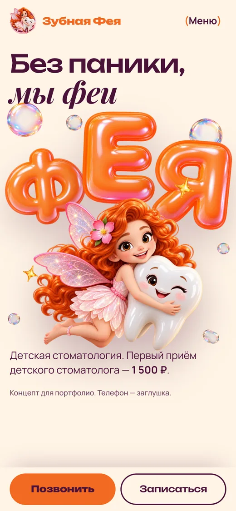
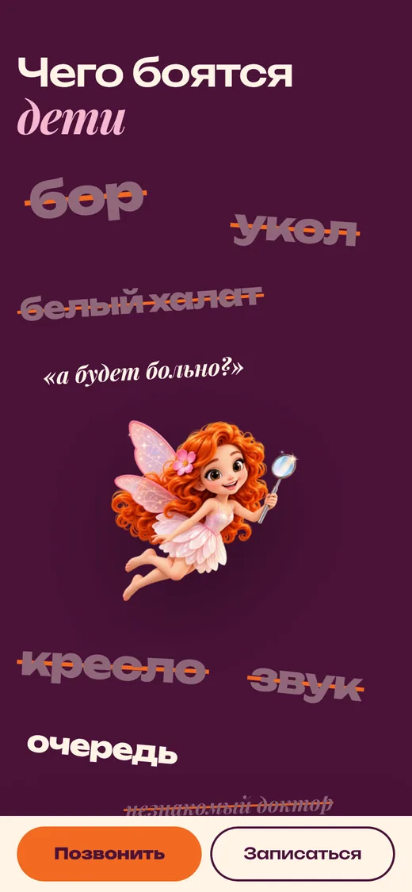
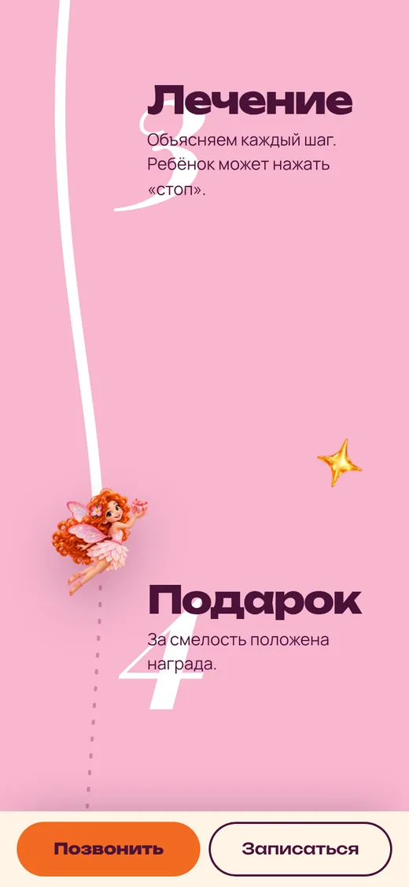
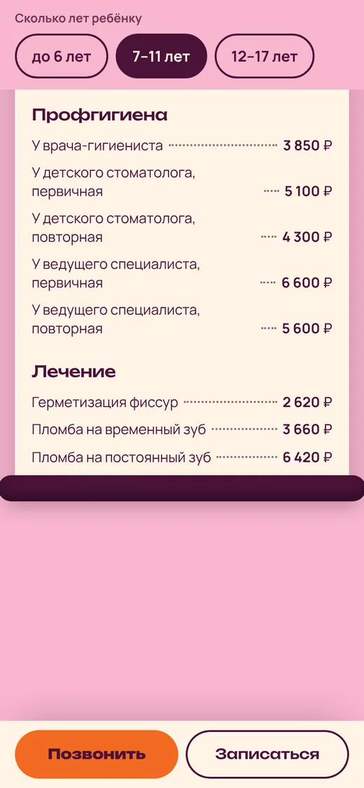
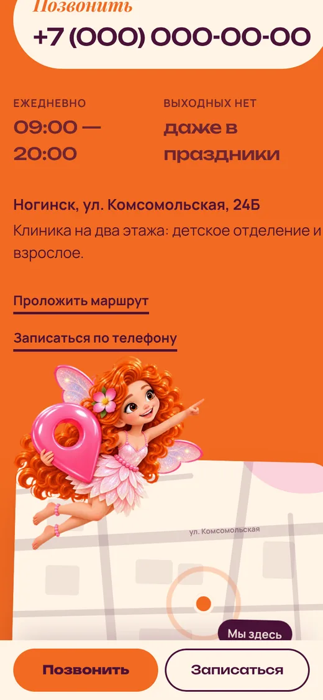
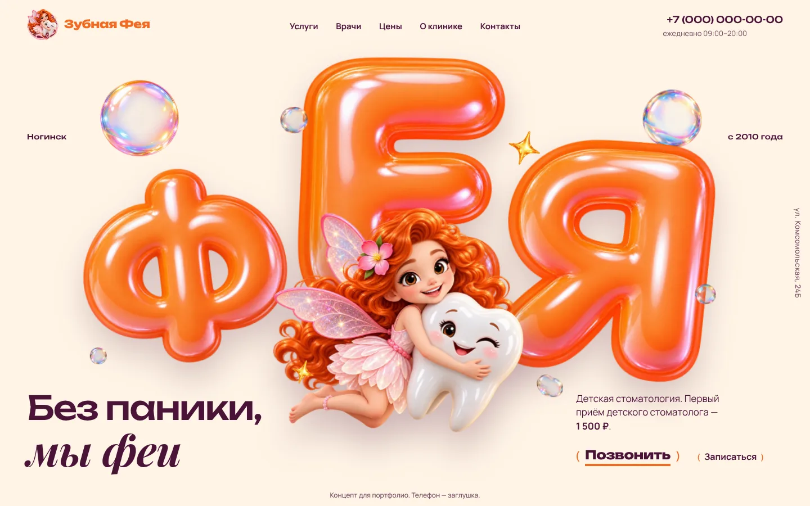
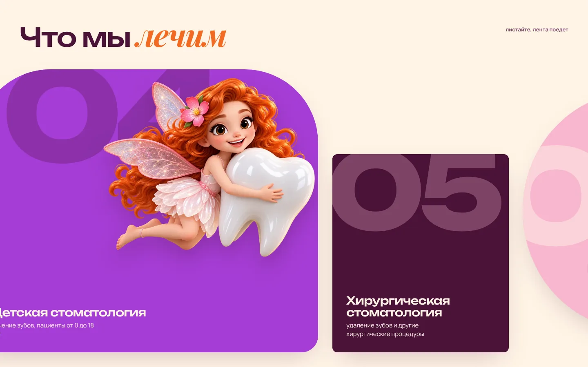

# Зубная Фея: концепт сайта детской стоматологии

Адаптивный одностраничный сайт для детской клиники в Ногинске. Сказочный журнал: 3D-феи, надувные буквы и цифры, у каждого блока своё движение при скролле.

## 🌐 Live Demo

- Сайт: https://deniyache.github.io/zubnaya-feya/
- Разбор работы (как сделан, что внутри): https://deniyache.github.io/zubnaya-feya/case.html

Лучше открывать с телефона: мобильная версия основная.

## 📋 О проекте

Задача: сделать визит к стоматологу менее страшным для ребёнка и понятным для родителя. На первом экране фея и слоган «Без паники, мы феи», дальше блоки отвечают на вопросы родителя по порядку: чего боятся дети, какие услуги, как проходит первый приём, сколько стоит, как записаться.

Это портфолио-концепт, а не официальный сайт клиники. Название и город использованы как учебный пример, телефон, врачи и отзывы условные. Страницы закрыты от индексации (`noindex`).

## ✨ Возможности

- 10 блоков со своей композицией: первый экран, страхи (слова зачёркиваются), услуги (горизонтальная лента), первый приём (по линии летит фея), цифры, врачи, цены (чек печатается, выбор по возрасту), отзывы (стикеры «приклеиваются»), контакты с картой-схемой, подвал с документами
- Мобильная версия первична: кнопки «Позвонить» и «Записаться» всегда под рукой
- Один общий цикл анимаций на `requestAnimationFrame`, без событий `scroll`
- Запасной вариант без JavaScript и для `prefers-reduced-motion`
- Свои шрифты (без запросов к Google), изображения в WebP с прозрачностью
- Проверено на экранах 360, 390, 768, 1440 и 1920 px
- Мета-теги, иконки, Open Graph и Twitter-превью для красивой ссылки в мессенджерах

## 🛠️ Технологии

- HTML5
- CSS3: переменные, дизайн-токены (`tokens.css`)
- JavaScript (без фреймворков)
- Шрифты: Unbounded, Playfair Display, Manrope (лицензия OFL)
- WebP для графики
- GitHub Pages для публикации

## 📸 Превью

### Телефон

<p>
  
  
  
  
  
</p>

### Компьютер




Видео прокрутки на телефоне и остальные экраны: [страница-кейс](https://deniyache.github.io/zubnaya-feya/case.html).

## 🚀 Запуск локально

Сборки нет, это обычные статические файлы.

```bash
git clone https://github.com/Deniyache/zubnaya-feya.git
cd zubnaya-feya
python3 -m http.server 8000
```

Откройте http://localhost:8000.

## 📁 Структура проекта

```text
zubnaya-feya/
├── index.html        # сайт
├── case.html         # страница-кейс
├── style.css         # стили
├── tokens.css        # цвета, отступы, размеры
├── fonts.css         # подключение шрифтов
├── main.js           # анимации и интерактив
├── fonts/            # Unbounded, Playfair Display, Manrope + лицензии OFL
├── img/              # графика (WebP)
├── case/             # скриншоты и видео для страницы-кейса
├── favicon.ico, apple-touch-icon.png, icon-192.png
└── og-image.jpg      # превью для мессенджеров
```

## 🎨 Дизайн

- Цвета: кремовый `#FFF4E6`, оранжевый `#F26A21`, сливовый `#4A1238`, розовый `#F7B6CF`, фиолетовый как редкий акцент
- Заголовки: Unbounded, акценты: Playfair Display курсивом, текст: Manrope

## 👨‍💻 Автор

Денис, Telegram: [@dionis_web](https://t.me/dionis_web), GitHub: [Deniyache](https://github.com/Deniyache)
